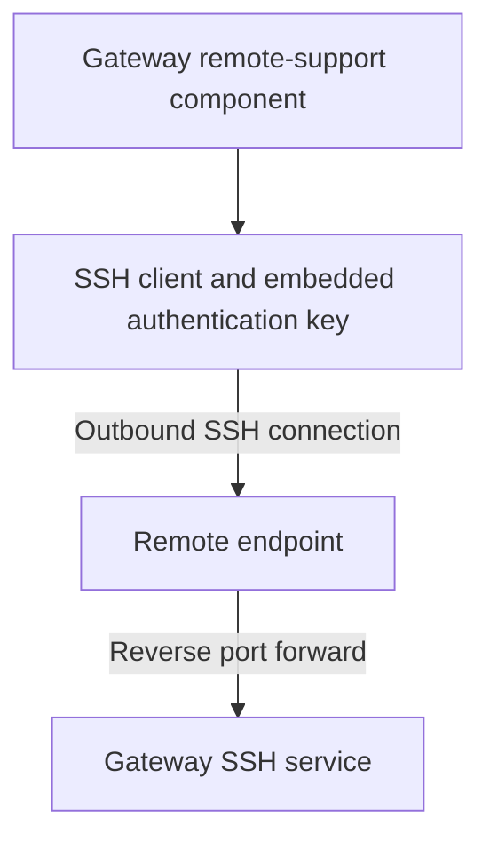

# TellStick ZNet Lite V2 — Hardware & Firmware Research

[](https://deepwiki.com/bobo843032/tellstick-znet-lite-v2-research)
[](https://creativecommons.org/licenses/by/4.0/)

Independent reverse engineering, firmware analysis, and technical documentation of the Telldus TellStick ZNet Lite V2.

The TellStick ZNet Lite V2 is a network-connected home automation gateway supporting 433 MHz devices and Z-Wave. Internally, it is an embedded Linux system based on the Atheros AR933x platform, with dedicated radio controllers, SPI flash storage, Ethernet networking, and an accessible serial console.

This repository documents the device’s hardware architecture, boot process, firmware, internal communication interfaces, application components, and capabilities not exposed through its standard user interface.

Research was conducted on personally owned hardware through physical inspection, UART communication, filesystem analysis, runtime diagnostics, and controlled experiments.

A key discovery is that the gateway contains a fully functional 2.4 GHz Wi-Fi interface, despite being primarily marketed as an Ethernet-connected device.

## Documentation

Start with the hardware overview, then follow the interface or subsystem under investigation.

| Document | Contents |
| --- | --- |
| [Hardware architecture](docs/hardware.md) | Components, memory, flash, interfaces and evidence limits |
| [UART console and U-Boot](docs/uart-and-uboot.md) | Serial bridge, original boot banner, commands and recovery limits |
| [Firmware and filesystem](docs/firmware.md) | OpenWrt, partition layout, application startup and upgrade research |
| [Undocumented Wi-Fi](docs/undocumented-wifi.md) | Authentic boot excerpts and summarized connectivity tests |
| [RF433 subsystem](docs/rf433.md) | PIC/MAX7030 architecture and application-visible data |
| [Z-Wave subsystem](docs/zwave.md) | Separate USB controller and unresolved interoperability questions |
| [Remote support](docs/remote-support.md) | Embedded-key location, controlled forwarding test and authentication boundaries |
| [Sanitized boot-log selection](docs/logs/boot-log-sanitized.txt) | Selected excerpts and explicitly identified observation summaries; not a complete raw log |
| [Security policy](SECURITY.md) | Publication rules, private reporting and research scope |
| [License](LICENSE) | CC BY 4.0 scope and third-party exclusions |

**Status:** UART and Wi-Fi were verified on the examined unit running stock firmware 1.3.2. Radio-controller internals, the full upgrade trust model and other hardware revisions remain open research areas. See [Research Status](#research-status) for the full inventory.

Navigate this overview: [findings](#research-highlights) · [hardware](#hardware-architecture) · [methodology](#research-methodology) · [security](#security) · [license](#license).

## Research Highlights

| Area | Finding | Status |
| --- | --- | --- |
| Processor | Atheros AR9330/AR9331 platform | Confirmed |
| Memory | 64 MB DDR2 | Confirmed |
| Flash | Winbond W25Q128, 16 MB SPI NOR | Confirmed |
| Bootloader | U-Boot 1.1.4 | Confirmed |
| Operating system | OpenWrt Designated Driver r49388 | Confirmed |
| Kernel | Linux 4.1.23, MIPS 24Kc | Confirmed |
| Wi-Fi | Functional integrated 2.4 GHz interface | Tested |
| Ethernet | Integrated wired networking | Confirmed |
| RF433 | MAX7030 transceiver and PIC18F25K50 MCU | Identified |
| Z-Wave | Sigma Designs controller | Identified |
| USB | Two internal CDC ACM interfaces | Confirmed |
| Filesystem | SquashFS with JFFS2 overlay | Confirmed |
| Remote support | SSH authentication and reverse forwarding | Investigated |
| Application | Python-based Telldus server and plugins | Investigated |

All findings relate to the examined hardware running stock firmware version 1.3.2 unless otherwise stated.

## Hardware Architecture

The device combines a general-purpose Linux system with dedicated controllers for radio communication.

| Component | Identification | Function |
| --- | --- | --- |
| Main processor | Atheros AR933x | Linux, networking, USB |
| RAM | 64 MB DDR2 | System memory |
| Flash | Winbond W25Q128 | Firmware storage |
| RF433 transceiver | Maxim MAX7030 | ASK/OOK radio |
| RF433 microcontroller | Microchip PIC18F25K50 | Radio interface and processing |
| Z-Wave controller | Sigma Designs | Z-Wave communications |

### Logical Architecture

- TellStick ZNet Lite V2
  - Atheros AR933x
    - MIPS 24Kc CPU
    - OpenWrt / Linux 4.1.23
    - Ethernet (eth0)
    - Wi-Fi (phy0 / wlan0)
    - UART (ttyATH0)
    - SPI NOR flash (16 MB)
    - USB host
      - Internal USB hub
        - RF433 controller
          - PIC18F25K50
          - MAX7030
        - Z-Wave controller
          - Sigma Designs

This outline represents the observed logical architecture rather than a complete electrical schematic.

## Serial Console and U-Boot

The gateway exposes a serial console operating at 115200 baud, 8N1, using 3.3 V UART signaling.

The bootloader can be interrupted during startup, providing access to an interactive U-Boot command environment.

### Captured Bootloader Identification

```text
U-Boot 1.1.4 (Apr 28 2015, 09:40:42)
AP121 (AR9331) U-Boot for Telldus TellStick ZNet Lite
DRAM:   64 MB DDR2 16-bit
FLASH:  Winbond W25Q128 (16 MB)
CLOCKS: 400/400/200/33 MHz (CPU/RAM/AHB/SPI)
```

The available bootloader commands include:

```text
bootm
dhcp
help
httpd
md
ping
printenv
printmac
reset
startnc
startsc
tftpboot
version
```

Notable functionality includes an HTTP firmware recovery server, network console support, and direct access to bootloader environment information.

Additional commands can modify flash memory and persistent device parameters. Such operations require an appropriate recovery strategy.

## Operating System and Firmware

The installed firmware is based on OpenWrt Designated Driver.

### System Identification

```text
OpenWrt Designated Driver r49388
Linux 4.1.23
MIPS 24Kc
BusyBox 1.24.2
Python 2.7
CherryPy 3.7.0
```

### Captured Kernel Identification

```text
CPU0 revision is: 00019374 (MIPS 24Kc)
SoC: Atheros AR9330 rev 1
MIPS: machine is Telldus TellStick ZNet Lite v2
```

Kernel command line:

```text
board=TELLSTICK-ZNET-LITE-V2 console=ttyATH0,115200 rootfstype=squashfs,jffs2 noinitrd
```

The bootloader identifies an AR9331-based AP121 platform, while Linux reports AR9330 revision 1. Both identifications are preserved as observed.

The firmware uses a read-only SquashFS root filesystem with writable JFFS2 storage.

### Flash Partition Layout

| Partition | Start | End |
| --- | --- | --- |
| u-boot | 0x000000 | 0x020000 |
| kernel | 0x020000 | 0x150AD8 |
| rootfs | 0x150AD8 | 0xFF0000 |
| rootfs_data | 0xBF0000 | 0xFF0000 |
| art | 0xFF0000 | 0x1000000 |
| firmware | 0x020000 | 0xFF0000 |

The firmware region is an aggregate partition, and rootfs_data occupies part of the root filesystem region.

The ART partition contains hardware-specific calibration data and should not be treated as interchangeable between devices.

A complete flash backup was obtained and preserved privately. Firmware dumps and calibration data are not distributed.

## Undocumented Wi-Fi Functionality

One of the most significant discoveries is the presence of an operational 2.4 GHz Wi-Fi interface.

Although the TellStick ZNet Lite V2 is primarily presented as an Ethernet-connected gateway, the underlying Atheros platform includes an integrated wireless MAC.

The stock firmware initializes the interface through the Linux wireless subsystem.

### Original Kernel Log

```text
[   12.154904] ieee80211 phy0: Atheros AR9330 Rev:1 mem=0xb8100000, irq=2
[   24.199626] IPv6: ADDRCONF(NETDEV_UP): eth0: link is not ready
[   25.717851] IPv6: ADDRCONF(NETDEV_UP): wlan0: link is not ready
```

These messages confirm that the wireless hardware is recognized and initialized by the kernel.

### Wireless Configuration

The installed OpenWrt configuration references the integrated wireless MAC:

```text
config wifi-device 'radio0'
    option type 'mac80211'
    option channel '11'
    option hwmode '11g'
    option path 'platform/ar933x_wmac'
    option htmode 'HT20'
    option disabled '0'
```

The interface was configured in station mode using WPA2-PSK authentication.

### Functional Verification

The following operations were successfully demonstrated:

- Scanning for nearby wireless access points
- Detecting surrounding 2.4 GHz networks
- Associating with a WPA2 access point
- Establishing a working wireless connection
- Obtaining an IPv4 address through DHCP
- Communicating over the wireless interface

Recorded link characteristics:

```text
Interface:    wlan0
Frequency:    2462 MHz
Signal:       -56 dBm
TX bitrate:   57.8 Mbit/s
Modulation:   MCS 5
```

These values are taken from the earlier functional test and summarized here rather than represented as an unmodified terminal capture.

The Wi-Fi capability is therefore functional, not merely an unused driver or dormant kernel feature.

The reason this capability was not exposed as a supported product feature remains unknown.

Potential explanations include platform reuse, simplified device provisioning, product requirements, support costs, and certification considerations. These are hypotheses, not established manufacturer decisions.

## Internal USB Architecture

The Linux kernel detects two internal USB CDC ACM serial interfaces.

### Captured Kernel Output

```text
[   11.839356] cdc_acm 1-1.1:1.0: ttyACM0: USB ACM device
[   11.844816] cdc_acm 1-1.4:1.0: ttyACM1: USB ACM device
```

The interfaces correspond to separate radio subsystems.

| Device | Function |
| --- | --- |
| /dev/ttyACM0 | 433 MHz controller |
| /dev/ttyACM1 | Z-Wave controller |

These interfaces provide communication between the Linux host and the dedicated radio hardware.

## RF433 Subsystem

Hardware examination identified two primary components:

### Maxim MAX7030

An ASK/OOK radio transceiver associated with the 433 MHz subsystem.

### Microchip PIC18F25K50

A microcontroller responsible for interfacing with the radio hardware and communicating with the Linux host.

The Linux application communicates with this subsystem through /dev/ttyACM0.

The application-level protocol contains structured messages and decoded information.

An important distinction is that the software event rf433RawData does not necessarily contain raw RF waveforms or unprocessed pulse timing.

In the examined software path, incoming data has already passed through serial handling and parts of the protocol-processing stack.

Direct access to lower-level RF information would require additional investigation of the PIC firmware and associated hardware signals.

## Z-Wave Subsystem

The device contains a separate Sigma Designs Z-Wave controller.

The controller communicates with the Linux host through /dev/ttyACM1.

The Z-Wave subsystem is distinct from the RF433 transceiver and microcontroller.

The presence of a sub-GHz radio does not establish arbitrary radio reception or software-defined-radio functionality.

Such capabilities would require additional hardware and firmware analysis.

## Application and Plugin Architecture

The gateway runs a Python-based application stack.

Identified components include:

- Python 2.7
- CherryPy
- Telldus device and protocol modules
- RF433 and Z-Wave adapters
- Python package entry points
- Startup and plugin initialization logic
- Firmware upgrade utilities
- Remote-support components

The main application entry point is:

```text
/usr/bin/tellstick-znet.py
```

The firmware upgrade utility is located at:

```text
/usr/bin/tellstick-upgrade.py
```

The installed application uses a modular architecture, but the production startup sequence also includes explicitly defined initialization behavior.

Consequently, installing a new Python package or registering an entry point does not necessarily cause the production application to load it automatically.

This behavior is relevant to independent integration, debugging, and application extension.

## Remote Support and Embedded SSH Key

The firmware contains a remote-support component built around SSH.

The mechanism establishes an outbound SSH connection from the gateway to a remote endpoint and uses reverse port forwarding to expose a local service through that connection.

### Observed Architecture



### Embedded Private Key

Filesystem inspection identified the remote-support package:

```text
Telldus_Remotesupport-0.1-py2.7.egg-info
```

The installed package contains a private-key file at:

```text
/usr/lib/python2.7/site-packages/remotesupport/id_rsa
```

File identification indicated:

```text
PEM RSA private key
```

The key material is associated with authentication of the outbound SSH support connection.

Its presence in the installed filesystem means that the authentication material can be recovered by someone with sufficient filesystem access.

The private key itself is not included in this repository.

### Reverse SSH Forwarding

The support component uses an outbound authenticated SSH session and requests reverse port forwarding.

This arrangement allows a remote endpoint to communicate with a service on the gateway through the established SSH connection.

Controlled testing against a researcher-operated SSH endpoint reproduced the relevant forwarding behavior.

The test confirmed the forwarding mechanism, but did not establish that possession of the embedded key provides access to Telldus-operated infrastructure or arbitrary customer devices.

### Security Implications

Several properties are important when evaluating this implementation:

- Authentication material is present in the installed firmware filesystem.
- The support mechanism initiates an outbound connection.
- Reverse forwarding provides a path to a local gateway service.
- The embedded key authenticates the outbound SSH connection.
- Access to the gateway’s local SSH service remains subject to that service’s authentication requirements.

The reverse-support mechanism is not, by itself, an authentication bypass of the gateway’s local SSH server.

The broader security impact depends on key reuse, remote-server authorization, deployment configuration, and whether the authentication material is shared between devices or firmware versions.

Those properties have not been conclusively established by the local experiment.

No usable credentials, private-key contents, or operational third-party support endpoints are published.

## Research Methodology

### Hardware Inspection

Identification of integrated circuits, physical interfaces, connectors, and radio components.

### Serial Communication

UART access was used to capture the boot sequence, inspect U-Boot, and interact with the running Linux system.

### Firmware Examination

The filesystem was examined to identify installed applications, configuration files, Python packages, startup behavior, and remote-support components.

### Runtime Diagnostics

Kernel logs, USB interfaces, wireless devices, network configuration, and application behavior were inspected.

### Controlled Experiments

Wi-Fi association and selected SSH forwarding behavior were tested against researcher-controlled systems.

Findings are distinguished from hypotheses where the available evidence does not support a definitive conclusion.

## Security

Use only owned or explicitly authorized hardware and researcher-controlled endpoints. Check UART signal levels before connecting equipment. Flash operations can erase firmware or unique ART calibration data; keep original backups private.

Review [SECURITY.md](SECURITY.md) before publishing evidence or reporting a vulnerability. The embedded SSH key and reverse tunnel do not establish a bypass of local SSH authentication.

## Evidence and Privacy

The research uses authentic technical observations wherever possible.

Published evidence is sanitized to remove identifying or sensitive information while preserving relevant technical details.

Excluded material includes:

- Personal names and usernames
- Identifying workstation and filesystem paths
- Network addresses and device identifiers
- MAC addresses and wireless BSSIDs
- Wi-Fi SSIDs and passwords
- Private SSH keys and authentication credentials
- API tokens and other secrets
- Device-specific calibration data
- Unmodified firmware images

Redactions are marked explicitly.

Reconstructed examples and summarized measurements are identified as such rather than presented as verbatim terminal captures.

## Research Status

| Research area | Status |
| --- | --- |
| UART console | Verified |
| U-Boot access | Verified |
| Linux boot analysis | Documented |
| Firmware identification | Documented |
| Flash partition layout | Documented |
| Filesystem inspection | Performed |
| Wi-Fi discovery | Verified |
| Wi-Fi connectivity | Successfully tested |
| RF433 hardware | Identified |
| Z-Wave hardware | Identified |
| Internal USB interfaces | Verified |
| Python application architecture | Investigated |
| Remote-support implementation | Investigated |
| Embedded SSH key location | Identified |
| Reverse SSH forwarding | Tested in controlled environment |
| Complete flash backup | Preserved privately |
| RF433 microcontroller firmware | Further investigation required |
| Complete electrical schematic | Not established |

## References

Relevant upstream projects:

- [Telldus GitHub organization](https://github.com/telldus)
- [tellstick-server](https://github.com/telldus?tab=repositories&q=tellstick-server)
- [tellstick-server-plugins](https://github.com/telldus?tab=repositories&q=tellstick-server-plugins)
- [tellstick-net](https://github.com/telldus?tab=repositories&q=tellstick-net)
- [tellstick-duo](https://github.com/telldus?tab=repositories&q=tellstick-duo)

Upstream repositories may have different licensing terms. Public availability of source code does not automatically authorize redistribution of every included component.

## License

See [LICENSE](LICENSE) for the documentation license and exclusions.

Original documentation and independently created research materials in this repository are licensed under the [Creative Commons Attribution 4.0 International License](https://creativecommons.org/licenses/by/4.0/), unless otherwise noted.

Third-party source code, vendor firmware, proprietary materials, trademarks, credentials, and device-specific data are not covered by this license.

Any independently written software added to this repository may be distributed under a separate license.

## Disclaimer

This is an independent research project and is not affiliated with, sponsored by, or endorsed by Telldus.

All research was performed on personally owned hardware using controlled experiments.

The documentation is provided for educational, interoperability, repair, and security-research purposes.

Hardware revisions, firmware versions, and deployment configurations may differ. Findings should not be assumed to apply universally to every TellStick device.

Telldus and TellStick are trademarks of their respective owners.
